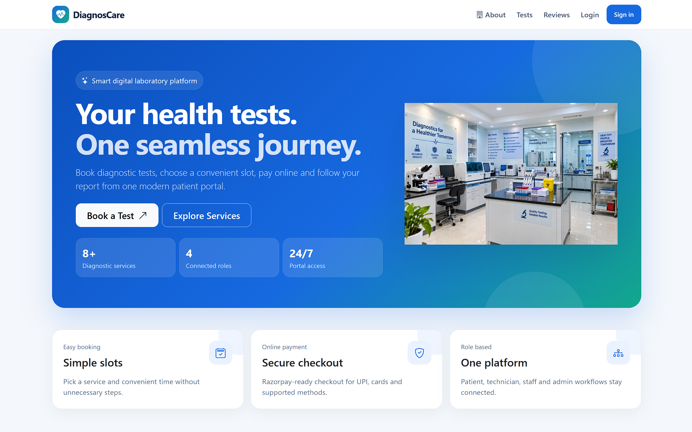
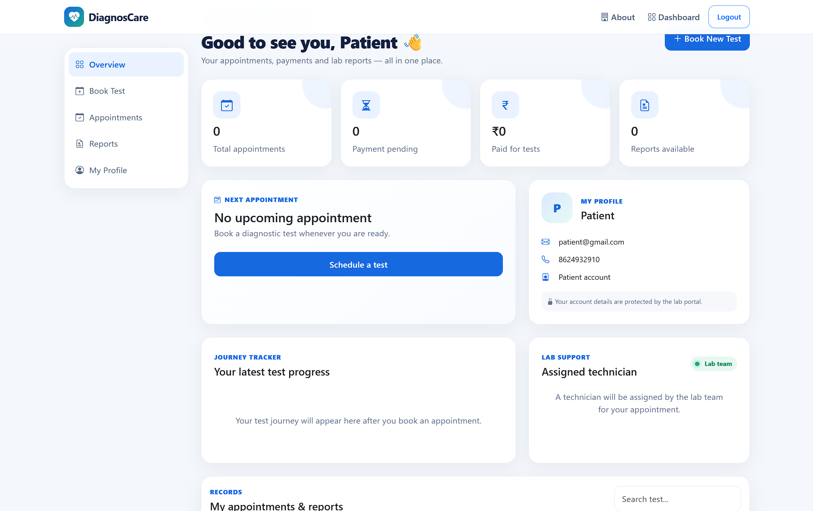
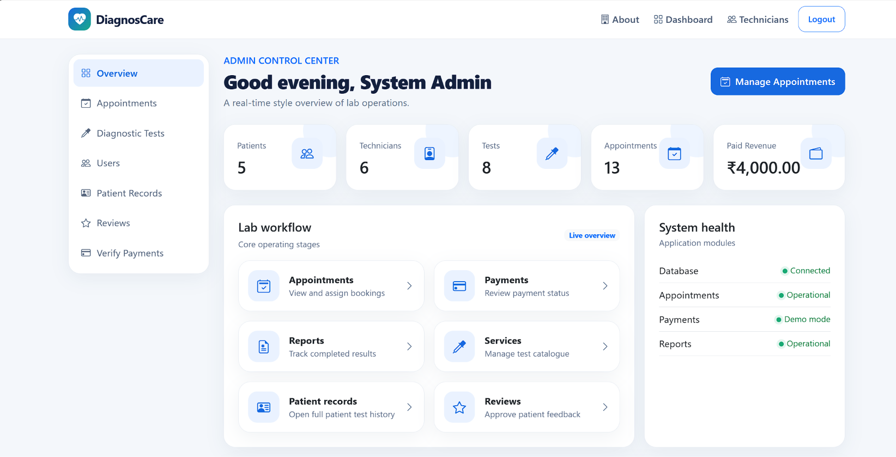
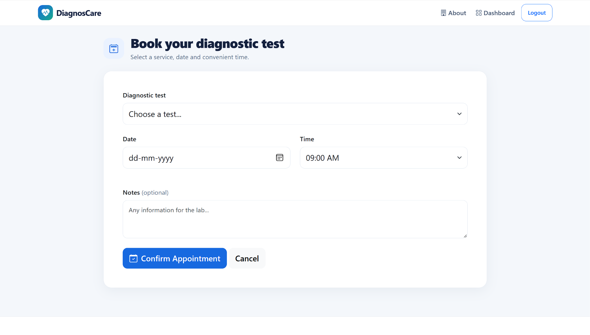
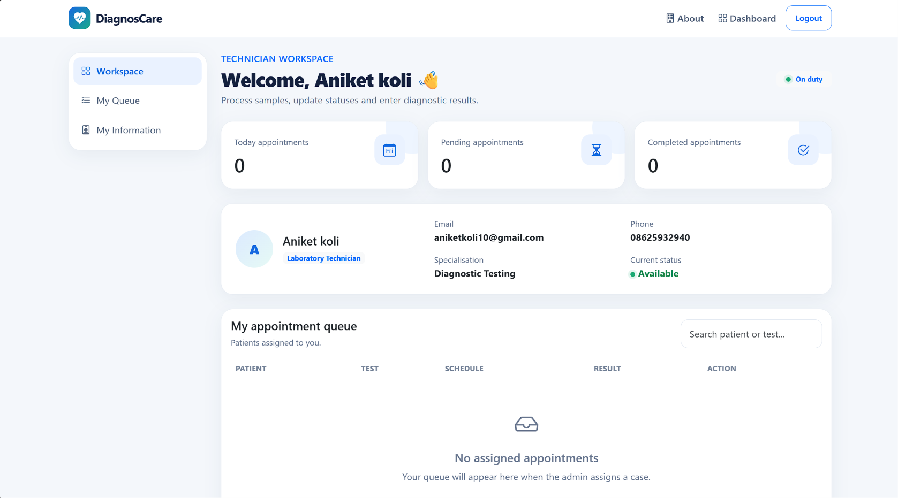

# DiagnosCare V5 – Diagnostic Lab Appointment and Payment System

A professional, responsive web-based Diagnostic Lab Appointment and Payment Management System developed using PHP, MySQL, Bootstrap 5 and JavaScript.

The system simplifies diagnostic laboratory operations by providing separate dashboards and functionality for patients, technicians, staff and administrators.

## 1. Project Overview

DiagnosCare V5 is designed to digitize laboratory appointment booking, diagnostic test management, patient records, payment processing and report management.

Patients can register, explore diagnostic tests, book appointments and track payment and appointment status. Laboratory staff can manage appointments and technicians, while administrators have complete control over the system.

## 2. Technologies Used

| Technology | Purpose |
|---|---|
| HTML5 | Website structure |
| CSS3 | Styling and design |
| Bootstrap 5 | Responsive interface |
| JavaScript | Client-side functionality |
| PHP 8+ | Backend development |
| MySQL | Database management |
| PDO | Database connectivity |
| Bootstrap Icons | Interface icons |
| XAMPP | Local development server |
| Razorpay | Payment gateway integration |

## 3. Key Features

### Patient Module
- Patient registration and login.
- Browse available diagnostic tests.
- View test details and prices.
- Book diagnostic appointments.
- Select appointment dates and time slots.
- Online payment interface.
- View appointment and payment status.
- Submit reviews and feedback.

### Admin Module
- Secure administrator login.
- Admin dashboard.
- Manage patient information.
- Manage diagnostic tests and pricing.
- Manage technicians and staff.
- Assign technicians to appointments.
- Manage patient appointments.
- View patient records and payment history.
- Manage and approve patient reviews.
- View laboratory reports.

### Technician Module
- Technician login.
- Technician dashboard.
- View assigned appointments.
- Access appointment details.
- Update appointment processing status.

### Staff Module
- Staff login.
- Staff dashboard.
- Manage assigned laboratory operations.

### Additional Features
- Professional and responsive user interface.
- About Us page.
- Laboratory infrastructure gallery.
- Technician profiles and certificates.
- Awards and achievements section.
- Google Maps integration.
- Contact information.
- Patient review system.

### Payment Integration
- Razorpay Standard Checkout integration.
- Server-side order creation.
- Payment signature verification.
- Payment status management.
- Demo payment configuration for project testing.

## 4. User Roles

The system supports four user roles:

| Role | Access |
|---|---|
| Admin | Complete system management |
| Patient | Test browsing, booking and payments |
| Technician | Assigned appointments |
| Staff | Laboratory operations |

## 5. Project Folder Structure

```text
Diagnostic_Lab_Appointment_System/
│
├── admin/
│   ├── dashboard.php
│   ├── appointments.php
│   ├── patients.php
│   ├── technicians.php
│   └── reviews.php
│
├── patient/
│   ├── dashboard.php
│   ├── appointment.php
│   ├── payment.php
│   └── review.php
│
├── technician/
│   ├── dashboard.php
│   └── appointment.php
│
├── staff/
│   └── dashboard.php
│
├── assets/
│   ├── css/
│   ├── images/
│   └── uploads/
│
├── config/
│   ├── app.php
│   ├── database.php
│   └── payment.php
│
├── database/
│   ├── diagnostic_lab.sql
│   └── upgrade_v5.sql
│
├── partials/
│
├── index.php
├── login.php
├── register.php
├── about.php
├── logout.php
└── README.md
```

## 6. Installation and Setup

Follow these steps to run the project locally.

**Step 1: Install XAMPP**

Download and install XAMPP with Apache and MySQL.

**Step 2: Clone the repository**

```bash
git clone https://github.com/Sudhatamatta95/Diagnostic_Lab_Appointment_System.git
```

**Step 3: Move the project**

Place the downloaded project folder inside:

```text
C:\xampp\htdocs\
```

**Step 4: Start XAMPP**

Start Apache and MySQL from the XAMPP Control Panel.

**Step 5: Create the database**

1. Open phpMyAdmin.
2. Create a database named `diagnostic_lab`.
3. Import `database/diagnostic_lab.sql`.

If you already have the original database, import `database/upgrade_v5.sql` instead of importing the original SQL again.

**Step 6: Configure database connection**

Open:

```text
config/database.php
```

Set your local MySQL database name, username and password.

**Step 7: Configure payment settings**

Open:

```text
config/payment.php
```

Configure Razorpay test credentials locally. Never upload secret keys to GitHub.

**Step 8: Run the project**

Open your browser:

```text
http://localhost/diagnostic_lab/
```

The application should now be accessible locally.

## 7. Demo Login Accounts

Use these demonstration accounts if they are configured in your local database.

| Role | Email | Password |
|---|---|---|
| Admin | admin@diagnosticlab.test | admin123 |
| Technician | technician@diagnosticlab.test | tech123 |
| Staff | staff@diagnosticlab.test | staff123 |
| Patient | patient@diagnosticlab.test | patient123 |

These are demonstration credentials only. Change default passwords before deployment.

## 8. Payment Integration

The project includes Razorpay Standard Checkout integration.

For testing:
- Use Razorpay Test Mode.
- Configure test Key ID and Key Secret locally.
- Verify payment signatures on the server.
- Do not publish secret credentials.

For production:
- Use activated LIVE credentials.
- Configure HTTPS.
- Use a secure production database.
- Protect payment credentials using environment variables.

## 9. Security Considerations

- Use secure password hashing.
- Validate user input.
- Use PDO prepared statements.
- Apply role-based access control.
- Protect sensitive configuration files.
- Never upload real patient information or payment credentials.
- Use demonstration payment details in the public repository.

## 10. Future Enhancements

- Email and SMS appointment notifications.
- Automated report generation.
- Downloadable PDF laboratory reports.
- Advanced analytics dashboard.
- Improved appointment scheduling.
- Online report access for patients.
- Enhanced payment tracking.

## 11. Project Information

**Project Name:** DiagnosCare V5 – Diagnostic Lab Appointment and Payment System

**Project Type:** Full-Stack Web Application

**Course:** Third Year BBACA

**Academic Project:** TY BBACA

**Developer:** Sudha Tamatta

**GitHub Repository:**

https://github.com/Sudhatamatta95/Diagnostic_Lab_Appointment_System

## 12. Conclusion

DiagnosCare V5 provides a centralized digital platform for managing diagnostic laboratory activities. It simplifies appointment booking, patient management, technician assignments and payment processing.

The project demonstrates practical implementation of PHP, MySQL, frontend development, database connectivity, authentication and role-based access control.

## 10. Project Screenshots

### Homepage


### Patient Dashboard


### Admin Dashboard


### Appointment Booking


### Payment Page
